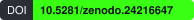
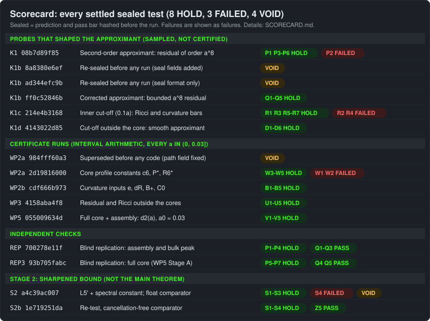
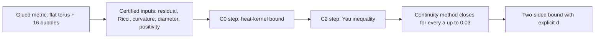

# A certified closeness bound for a Kummer K3 surface

**For one Kummer K3 surface, a glued, hand-built geometry is proved, with interval arithmetic, to lie within an explicit distance of the true Ricci-flat one for every bubble size up to 0.03 (at most 0.121974 at 0.03), making Kobayashi's qualitative 1990 estimate explicit.**

[](https://doi.org/10.5281/zenodo.24216647)  [](https://github.com/Hashirama1337s)

Moki & Julio · 2026 · version 1.0

**Read** [paper.md](paper.md) · **Re-run** [code/RUN.md](code/RUN.md) · **Check** [CLAIMS.md](CLAIMS.md) and [SCORECARD.md](SCORECARD.md)

## In plain words

A K3 surface is a four-dimensional shape that carries a perfectly balanced geometry, a Ricci-flat metric. Yau proved
in 1978 that this geometry exists, but nobody can write it down by a formula.

The Kummer construction gets close by hand. Take a flat four-dimensional torus built on a very symmetric grid (the
Hurwitz lattice), fold it in half, and smooth each of the 16 sharp corner points with a small, known bubble of size a
(an Eguchi-Hanson metric). Since 1990 it has been known that the perfect geometry is close to the glued one "if a is
small enough". How small, and how close, was never computed.

We computed both and proved them with a computer that carries a guaranteed error bar on every number. For every bubble
size a up to 0.03, the perfect geometry stretches or shrinks the glued one by at most a factor 1/(1 − d), with d at
most 0.002851 at a = 0.01 (under 0.3 percent) and at most 0.121974 at a = 0.03.

**The idea in one picture.** A tailor's suit and a perfect fit. Earlier work proved that the suit fits well when the
bubbles are small. We give the measurement, with a guarantee, for every bubble size up to 0.03. **Where the picture
breaks.** The fit is checked at every point and in every direction at once, and the guarantee comes from a proof,
not from measuring.

## At a glance

- **Claim (computer-assisted).** For every a in (0, 0.03]: (1 + d(a))^-1 ω_a ≤ ω_CY ≤ (1 − d(a))^-1 ω_a, with
  d(0.01) ≤ 2.851e-3, d(0.03) ≤ 0.121974, d(a)/a^3 ≤ 2275.00 for a in (0, 1e-4], and limsup d(a)/a^3 ≤ 2269.27
  (the a = 0 value of a continuous bound; it does not bound d(a)/a^3 at any a > 0). Upper bounds are rounded up.
- **Where it stops.** a0 = 0.03 is the proved range of our diameter lemma, not a limit of the method: the
  continuity-method smallness quantity is at most 1.1694 there, against the threshold 2.
- **How.** The continuity method of Kobayashi and Lye with every constant explicit: a Li-Yau/Doeblin heat-kernel
  bound for the C^0 step, Yau's second-order inequality for the C^2 step, and certified inputs (residual, Ricci,
  curvature, diameter, positivity) from four interval-arithmetic runs.
- **Conditions.** IEEE floating-point outward rounding in parts of three runs; standard facts whose sources we did not
  open (heat-kernel facts, Yau and Calabi, Schauder theory, the F4 Weyl chamber); the review status in
  [What we do not claim](#what-we-do-not-claim).
- **Not new.** The qualitative estimate (Kobayashi 1990, Lye 2023, Jiang 2025), the method, and the Green-sum structure of
  the correction (Fu, Xiao and Yau). New: the explicit certified constants and interval. Full credit in
  [paper.md](paper.md), Section 8.
- **Checked.** Clean-room rebuild identical to the originals; all three load-bearing pieces (the assembly, the bulk
  residual peak, the full core) replicated by blind independent code; nine hostile referee reports; the algebraic
  steps of two lemmas checked in Lean. Not replicated blind: the curvature certificate and the outer-region cover.
- **Honesty.** Every test was sealed before its run: 15 settled seals, 8 HOLD, 3 FAILED, 4 VOID.



## What we do not claim

- No better rate than the known one: our order a^3 comes from the approximant's a^8 residual; the qualitative
  method on the same approximant gives the same order.
- Not a certified K3 metric in general: this is one Kummer surface (Hurwitz lattice, 16 equal bubbles). Certified
  metrics on the Fermat quartic, a different K3 at a fixed Kähler class, are due to Douglas, Gómez-Serrano, Lehmann,
  Platt and Qi, and to Liu and Zhang.
- The certificate run WP2a was scored FAILED as sealed: two predictions used rounded constants as containment targets.
  Its exact enclosures are valid and are what the proof uses.
- The prediction V5 of the assembly run is POST HOC.
- The last text edits of the analysis chain and the definitions are not re-refereed; several lemmas had one referee
  pass each. The blind replication of the full core produced its results before its instrument file was pinned
  (disclosed in its verdict).
- The floating-point layer (IEEE round-to-nearest with outward rounding) is an assumption every certified line rests on.

## How it works

### The idea



### A worked example

At a = 0.01 the certified inputs are the residual constant C_q ≤ 17226.21 (the logarithm of the ratio of the two volume forms is at
most C_q a^8 in size), the curvature input a^2 C0 ≤ 2.0000353, and the heat-kernel constant Γ̂(0) ≤ 4.530841. The chain
turns them into d(0.01) ≤ 2.851e-3: the true metric and the glued one agree to within about 0.3 percent in every
direction at every point. Every interval of width 0.001 from 0 to 0.03 is listed in [paper.md](paper.md),
Appendix A.

## Reproduce and reuse

```
git clone https://github.com/Hashirama1337s/certified-kummer-k3
cd certified-kummer-k3
pip install python-flint==0.9.0 numpy mpmath
python code/run_chain.py --from-shipped
```

Expected last line: `[run_chain] ALL IDENTICAL` (the assembly from the shipped inputs, about one minute). Without
`--from-shipped` the runner re-runs the whole chain (about 35 to 70 minutes). Details: [code/RUN.md](code/RUN.md).

Reusable pieces: `tools/numcheck.py` traces every printed number to a result file and checks its rounding direction;
`code/wp5/wp5.py` evaluates the explicit continuity-method bound in ball arithmetic and can be fed other certified
inputs.

## Words you will meet

- **K3 surface**: a four-dimensional shape that admits a Ricci-flat metric.
- **Ricci-flat metric**: a geometry in which volumes do not change on average along geodesics; the "perfect" one here.
- **Kummer construction**: fold a flat torus in half and smooth the 16 corner points.
- **Eguchi-Hanson bubble**: the known Ricci-flat smoothing of one corner point; a is its size.
- **Interval (ball) arithmetic**: every number is stored with a guaranteed error bar, so results are bounds.
- **Continuity method**: deform the glued metric step by step into the perfect one while keeping control.
- **Sealed test**: a prediction and its pass bar hashed before the run, scored as written.

## How to cite

```
Moki & Julio (2026). A computer-certified closeness bound for the Kummer K3 surface of the Hurwitz lattice. Version 1.0. Zenodo. https://doi.org/10.5281/zenodo.24216647
```

The DOI always resolves to the newest archived version. Version 1.0 is 10.5281/zenodo.24216648. Machine-readable: [CITATION.cff](CITATION.cff). Text and data: CC BY 4.0 (`LICENSE`). Code: MIT (`LICENSE-CODE`).

## Related projects

- [certified-evans-coleman](https://github.com/Hashirama1337s/certified-evans-coleman): a certified Evans-Coleman critical solution of radiation collapse, with exactly one growing spherical mode
- [certified-bowen-york-spin](https://github.com/Hashirama1337s/certified-bowen-york-spin): certified spin, mass and horizons of the Bowen-York spinning black-hole family
- [certified-chen-lebrun-weber](https://github.com/Hashirama1337s/certified-chen-lebrun-weber): a certified approximation of the Chen-LeBrun-Weber Einstein metric
- [large-d-gregory-laflamme](https://github.com/Hashirama1337s/large-d-gregory-laflamme): the Gregory-Laflamme threshold of a black string as an exact large-dimension series
- All projects: [the Moki & Julio lab map](https://github.com/Hashirama1337s)

---

*Prepared with AI assistance; what was checked, and by what, is stated above.*
